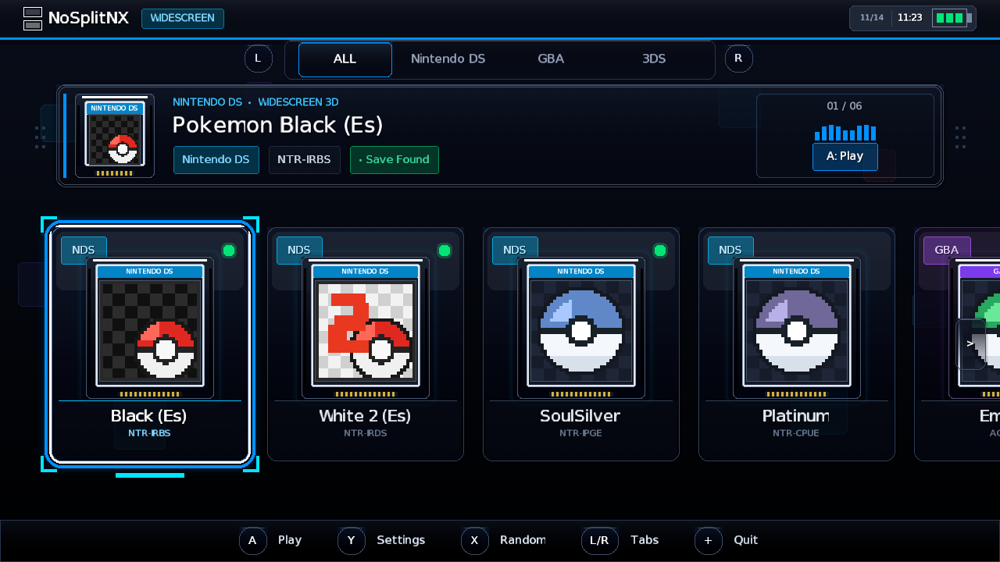
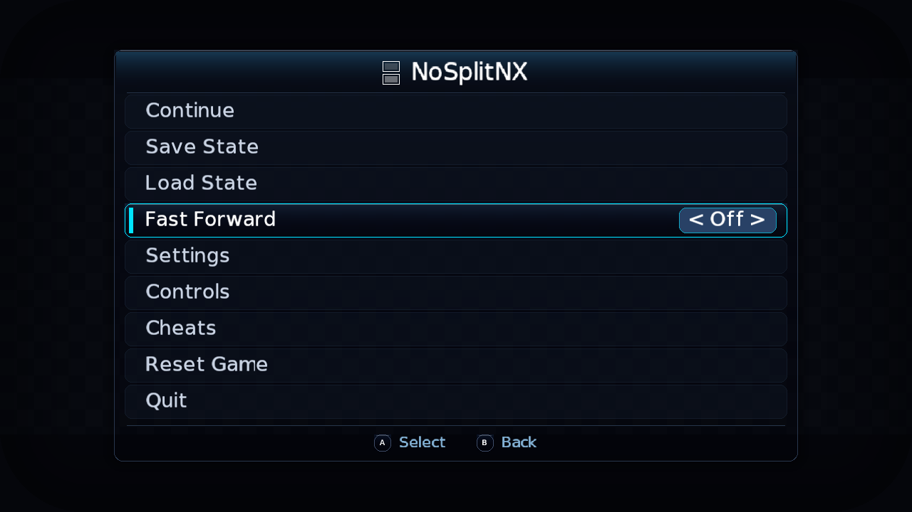
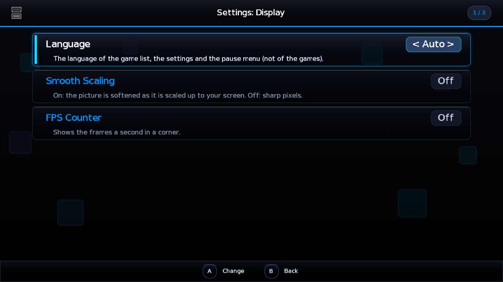
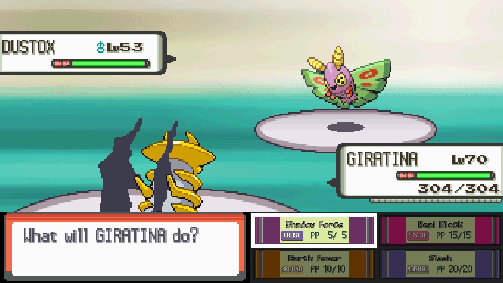
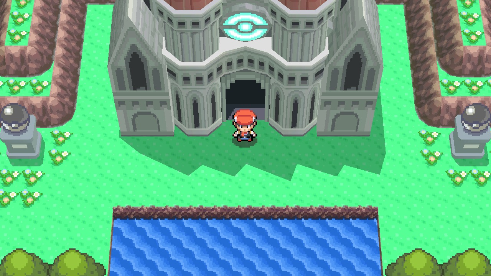

# NoSplitNX

**Every DS, GBA and GB/GBC Pokémon game in one Nintendo Switch homebrew: one screen, widescreen, 60 fps at 720p, with a built-in PokeDaisy Companion, Field HUD, Quick Menu and Rewind.** No more squinting at two stacked DS screens.

NoSplitNX is a Switch-only program with a console-style game list, a built-in DS core and a built-in GB/GBC/GBA player. It handles clean games, regional versions and ROM hacks, and has HOME Menu icons, cover downloads, cheats, RetroAchievements and a live PokeDaisy Companion (Pokédex, Party, Bag, World Map and Walkthrough Guide). You bring your own ROMs; the download contains no game code or assets.

| Download | Install |
|---|---|
| [**nosplitnx-switch.zip**](../../releases/latest) (latest release) | [Quick setup](#quick-setup) |

---

## What you can play

| Console | Games |
|---|---|
| **Nintendo DS** | Black 2, White 2, Black, White, SoulSilver, HeartGold, Platinum, plus Diamond and Pearl (experimental) |
| **Game Boy Advance** | Emerald, FireRed, LeafGreen, Ultra Violet, Generation 3 Evolved, plus dynamic widescreen for dozens of decomp hacks |
| **Game Boy / Color** | Red, Blue, Yellow, Gold, Silver, Crystal, plus Crystal Legacy, Crystal Clear, Polished Crystal and more — in true widescreen |
| **ROM hacks** | DS, GBA and GB/GBC hacks of these games, as a patched ROM or as an `.ips`, `.ups`, `.bps` or `.xdelta` patch |
| **Languages** | English, Spanish, French, German, Italian, Japanese and Korean versions ([details](#regional-versions)) |

Each game is shown as **one 16:9 picture**. The touch screen's controls sit beside the action, the 3D world reaches the edges of the screen, and in-between frames bring it to 60 fps.

| | Standard DS emulator | NoSplitNX |
|---|---|---|
| **Screens** | Two 256×192 screens with large borders | One widescreen picture, with the touch controls beside the action |
| **3D world** | 4:3 at DS resolution | 16:9, drawn by the Switch's graphics chip |
| **Frame rate** | 30 fps 3D | 60 fps with in-between frames |
| **Interface** | A PC menu with a controller bolted on | Built for the Switch: controller, touch and Switch Lite text sizes |

---

## Quick setup

1. **Download [`nosplitnx-switch.zip`](../../releases/latest)** and extract it to the root of your SD card. This creates `/switch/nosplitnx/` with an empty `roms` folder in it.
2. **Copy your ROMs** (`.nds`, `.gba`, any file names) into `/switch/nosplitnx/roms/`. Put ROM hack patches in the same place: NoSplitNX finds the matching clean ROM and applies the patch for you.
3. On a Switch running Atmosphère, **hold R while starting any installed game** to open the Homebrew Menu with full memory (Album mode doesn't have enough memory and isn't supported).
4. Start **NoSplitNX** and pick a game.

On later starts NoSplitNX opens on the game you played last.

---

## The game list

| In-game pause menu | Settings |
|---|---|
|  |  |

- **Game showcase and cartridges:** the selected game appears in a 3DS-style showcase with its cartridge, serial, and whether a save exists. Games are shown as DS and GBA cartridge cards, with **ALL**, **DS** and **GBA** tabs.
- **Music from your own ROM:** when you select a game, the list plays its music, taken from the ROM you selected, with a sound visualiser. No audio ships with the program.
- **Covers:** add your own art to `icons/` (named after the game code, e.g. `IREO.png`, or after the ROM file). You can also pick **Download Covers** in the game list settings to fetch the missing covers online (Wi-Fi needed). [More on covers](#covers).
- **Your language:** menus follow the console's language (English, Spanish, Italian, French, German, Japanese or Korean). You can also choose a language under **Display → Language**, separate from the game's own language.
- **Themes:** colour themes for the list and menus.
- **Touch and controller:** every screen works by touch in handheld mode and by controller alone.

### HOME Menu icons (forwarders)

Start any game straight from the Switch HOME Menu, without a PC:

1. In the game list, press **Y** to open **Settings**.
2. Choose **HOME Menu Icons**.
3. An icon with the game's cover is installed for each game in `roms/`, ROM hacks included (sigpatches required). GBA games without a cover get a cartridge-style icon instead.

### Covers

**Download Covers** looks up box art for every game that doesn't have a cover yet, then saves it in `icons/`:

- **Clean games:** from the free Libretro Thumbnails collection. No account needed.
- **ROM hacks:** from [SteamGridDB](https://www.steamgriddb.com), if you add your free API key. Put the key in `/switch/nosplitnx/sgdb_api_key.txt`, or add `sgdb_api_key=YOURKEY` to `settings.cfg`.

---

## Controls

| Button | In game | In menus / game list |
|---|---|---|
| **D-pad / Left Stick** | Move | Navigate |
| **A / B** | DS A / B | Confirm / Back |
| **X / Y** | DS X / Y | **Y**: Settings |
| **L / R** | DS L / R | Switch tabs (ALL, DS, GBA) |
| **ZR** | Fast forward (hold or toggle, set in Controls) | – |
| **+** | Pause menu | Exit to the Homebrew Menu |
| **−** | DS Select | – |
| **Touchscreen** | Tap the game directly (handheld) | Tap and swipe |
| **Right Stick** | Move the touch cursor (docked); in DS overworlds, look around when zoom is on | – |
| **ZL** | Tap at the cursor | – |
| **R3** | Swap / show the second screen, or zoom the overworld | – |

Every button can be remapped under **Controls → Keys and Buttons**. In GBA games, **+** opens the pause menu and **+** and **−** together press GBA Start.

---

## Features in the games

- **Overworld zoom and look around (DS):** zoom steps of 1×, 1.5× and 2×, plus panning with the Right Stick. The view zooms back in for dialogue, menus and battles if **Auto Zoom In** is on.
- **Battle button styles:** the games' own Gen 5 buttons (**Strip**, the default) with Poké Ball party bars, plus **Sun and Moon**, **Corner**, **Panel** and **Classic**. HG-Engine's Mega Evolution button is supported in HeartGold and SoulSilver hacks.
- **Fast forward:** hold or toggle ZR.
- **Save backups:** a `backups` folder keeps dated copies of your saves, made at start-up and every 30 minutes of play. You can restore them from the pause menu.
- **Cheats:** see [Cheats](#cheats).
- **RetroAchievements:** see [RetroAchievements](#retroachievements).

---

## Use your own save

Saves live in `/switch/nosplitnx/saves/`. To carry on from another emulator, a flash cart or a cartridge dump (Checkpoint, JKSM, GodMode9), copy your `.sav` there under the game's name:

| Game | Save file name |
|---|---|
| Black 2 / White 2 | `black2.sav` / `white2.sav` |
| Black / White | `black.sav` / `white.sav` |
| SoulSilver / HeartGold | `soulsilver.sav` / `heartgold.sav` |
| Platinum | `platinum.sav` |
| Emerald / FireRed / LeafGreen | `emerald.sav` / `firered.sav` / `leafgreen.sav` |

- Other language versions get their own names (e.g. `heartgold-es.sav`, `platinum-fr.sav`), and ROM hacks get saves of their own, so they never overwrite the clean game's.
- DraStic/DeSmuME `.dsv` and Action Replay `.duc` files can be converted with [`tools/bw2/convert_save.py`](tools/bw2/convert_save.py).

---

## Regional versions

42 exact DS ROM versions are recognised. Each one is checked before it loads.

| Language | Games |
|---|---|
| French, German, Italian, Spanish, Japanese, Korean | Black, White, Black 2, White 2, SoulSilver, HeartGold, Platinum |
| Experimental | Diamond: English, Spanish, German, Italian. Pearl: English, French, Spanish, German, Korean |

GBA widescreen patches cover the English, French, German, Spanish, Italian and Japanese versions.

---

## Cheats

Action Replay codes, turned on and off from **Cheats** in the pause menu:

- **Built in:** 15 popular codes for every DS game (walk through walls, max money, Rare Candies, Master Balls, wild shinies, always catch, infinite HP/PP, double EXP, no encounters, fast hatching, all badges/TMs, full Pokédex).
- **Cheat database:** put a `usrcheat.dat` (e.g. DeadSkullzJr's) in `/switch/nosplitnx/cheats/`.
- **Your own codes:** a text file named after the game code (e.g. `IREO.txt` for Black 2) in the same folder.

---

## RetroAchievements

1. Open **RetroAchievements** from the pause menu (**+**) or Settings, turn it on and log in.
2. With Wi-Fi on, an achievement card slides in at every unlock, and a **Game Mastered** banner appears when you complete a set. Choose **Modern** or **Classic** under **RetroAchievements → Unlock Banner**.
3. Save states and fast forward stay available (casual mode).

---

## The games

### Pokémon Black 2 and White 2

| | |
|---|---|
|  |  |
|  |  |

- Single, double, triple and rotation battles, with HP boxes at the edges and the battle buttons beside them. The bag, party and menus are laid out for one screen.
- **Other Version Pokémon** in the pause menu lets you find either version's exclusives in the wild.

### Pokémon SoulSilver and HeartGold

| | |
|---|---|
|  |  |

- Johto and Kanto in widescreen, with your partner Pokémon walking behind you. The bag, Pokédex and party fit one screen.
- Battle Yes/No questions appear as buttons beside the message box.

### Pokémon Black and White

| | |
|---|---|
|  |  |
|  |  |

### Pokémon Platinum, Diamond and Pearl

| | |
|---|---|
|  |  |
|  |  |

- Sinnoh in widescreen, with snow and rain reaching the edges. The Underground is wider and gets a small radar map, and the Pokétch is a quick screen swap away. Diamond and Pearl use Platinum's layouts (experimental).

### The GBA games

- Emerald, FireRed, LeafGreen, Ultra Violet and Generation 3 Evolved, on a built-in widescreen GBA player: wider overworlds, extended battle backgrounds, and weather across the whole screen.
- **GBA ROM hacks** play too, with saves of their own. Hacks with a static widescreen patch (or compatible base engine) use it; dozens of decomp hacks without static patches (including *SoulGold*, *Heart & Soul*, *Lazarus*, *Seaglass*, *Odyssey*, *Gaia* and *Recharged Yellow*) get dynamic 1x overworld widescreen plus **Zoom and Look-Around** via [PokeDaisy](https://github.com/lidor30/pokedaisy) **WIDE**, while remaining unmapped hacks play at the GBA's normal size.
- The pause menu matches the game list's look and language.

---

## Recommended: sys-clk

For a steady 60 fps in 3D towns and battles, set up [sys-clk](https://github.com/retronx-team/sys-clk):

| | Handheld | Docked |
|---|---|---|
| **CPU** | 1581 MHz (1785 MHz for more headroom) | 1785 MHz |
| **GPU** | 460 MHz | 768 MHz |
| **Memory** | 1600 MHz | 1600 MHz |

NoSplitNX never changes the clocks itself. At stock clocks, busy 3D scenes may drop frames.

---

## How it works

NoSplitNX runs the [melonDS](https://melonds.kuribo64.net) DS core (with its JIT) and a widescreen [mGBA](https://mgba.io) player. On top of these, a layer follows what the game is showing (overworld, battle, bag, menu) and rearranges both DS screens into one widescreen picture. The widescreen 3D is drawn by the Switch's graphics chip, and in-between frames are added for 60 fps. Builds are made by GitHub Actions with devkitPro.

Developers: see [AGENTS.md](AGENTS.md) for the code layout, building and testing.

---

## Credits and licence

NoSplitNX started as a Switch fork of [mamesj/pokemon-fulldex](https://github.com/mamesj/pokemon-fulldex) and still uses its work. Thanks to:

- [mamesj/pokemon-fulldex](https://github.com/mamesj/pokemon-fulldex): the multi-game base, regional mappings and layouts.
- [ClickingMaster/ssrecomp](https://github.com/ClickingMaster/ssrecomp): the original single-screen SoulSilver project.
- [melonDS](https://melonds.kuribo64.net): DS emulation.
- [mGBA](https://mgba.io) and Pokémon GBA Widescreen: GBA emulation and widescreen patches.
- [PokeDaisy](https://github.com/lidor30/pokedaisy) by Lidor Itzhari (`Based on PokeDaisy by Lidor Itzhari - https://github.com/lidor30/pokedaisy`, `GPL-3.0`): dynamic GBA and GB/GBC widescreen rebuild (`WIDE`), Rewind, Free Flight, Field HUD, Quick Menu and the live Pokédex / Party / Bag / World Map / Guide Companion across GB, GBC, GBA and DS.
- [sphaira](https://github.com/ITotalJustice/sphaira): HOME Menu forwarder generation.
- DeadSkullzJr and libretro-database: cheat databases. Libretro Thumbnails and SteamGridDB: cover art.

Licensed under **GPL-3.0-or-later** (see [LICENSE](LICENSE)).
*Not affiliated with or endorsed by Nintendo, Game Freak or The Pokémon Company. Pokémon is a trademark of its respective owners.*

Made with ♥ by [IamCarron](https://github.com/IamCarron). Built with the help of AI.
